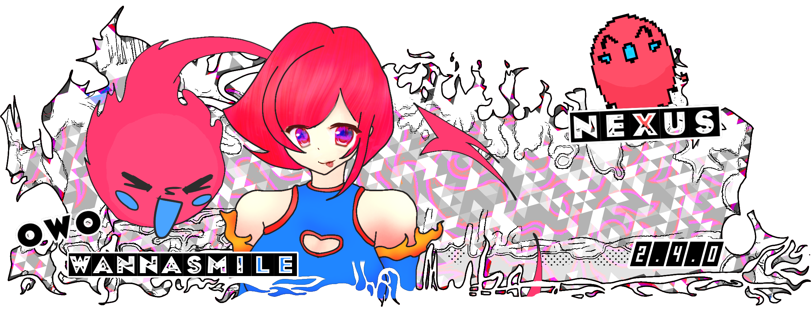

<h1 align="center">𝕨𝕒𝕟𝕟𝕒𝕤𝕞𝕚𝕝𝕖: 𝕟𝕖𝕩𝕦𝕤</h1>

<p align="center">
  <strong><em>"𝕒 𝕔𝕦𝕣𝕖 𝕥𝕠 𝕓𝕠𝕣𝕖𝕕𝕠𝕞"</em> -smiledemic</strong>
</p>

<p align="center">
  Founded by <a href="https://ankomstudios.com">Ankom Studios</a>
</p>

<p align="center">
  <a href="https://owo.ankomstudios.com">
    
  </a>
  
  
  
  
  <a href="https://ko-fi.com/ankomstudios">
    
  </a>
  <a href="https://open.spotify.com/artist/01JJmyvW0JjxC0fpLurTAR?si=sKugLrpKS6mHCvkg6AOwmQ">
    
  </a>
</p>


# 𝕧𝟚.𝟜.𝟘

**WannaSmile V2.4.0 is scheduled to drop tomorrow at 9:00 AM.** This update brings domain-based URLs, a profile revamp with public profiles, and a fix for global chat. It also restores the missing icons on pages 14-15, adds more ports and fixes, moves the project to a fully SQL-based setup, and updates outdated components.

### 𝕚𝕟 𝕥𝕙𝕖 𝕨𝕠𝕣𝕜𝕤

WannaSmile is continually evolving as a creative platform. The following features are in development or planned:

- GIF and sticker reactions within the DM system.
- An about:blank opener for displaying external content in a blank tab.
- **SoundScape V2** — An improved music experience with a larger library and lyrics support.

## 𝕥𝕖𝕔𝕙 𝕤𝕥𝕒𝕔𝕜

Explore the open-source WannaSmile project.

The site combines a JavaScript front end, SQL-backed library services, and JSON catalogs and data. Explore the sources, learn from them, and adapt the project to make it your own.

<p align="center">
  
  
  
  
  
  
  
  
  
  
  
  
</p>

# 𝕔𝕠𝕟𝕥𝕣𝕚𝕓𝕦𝕥𝕠𝕣𝕤

These are the contributors to WannaSmile. Check out their profiles and drop them a follow!

<p align="center">
  <a href="https://github.com/ankomstudios/wannasmile/graphs/contributors">
    
  </a>
</p>

<p align="center">
  <a href="https://github.com/ankomstudios/wannasmile/graphs/contributors">View All Contributors</a>
  &nbsp;·&nbsp;
  <a href="https://github.com/ankomstudios/wannasmile/graphs/commit-activity">Commit Activity</a>
</p>

## 𝕘𝕖𝕥𝕥𝕚𝕟𝕘 𝕤𝕥𝕒𝕣𝕥𝕖𝕕

WannaSmile is distributed at [owo.ankomstudios.com](https://owo.ankomstudios.com). The GitHub repository is the open-source codebase, not the primary distribution channel.

 <p align="right">

  <a href="https://owo.ankomstudios.com">
    <strong>𝕠𝕡𝕖𝕟 𝕨𝕒𝕟𝕟𝕒𝕤𝕞𝕚𝕝𝕖𝟜𝕖𝕧𝕣 →</strong>
  </a>
</p>

### Open source and contributions

The project source is released under the [MIT License](LICENSE). Third-party components retain their own licenses and notices. WannaSmile combines a JavaScript front end, SQL-backed library services, and JSON catalogs and data. The live site's deployment and configuration are specific to our domain and services, so a direct repository fork should not be expected to run as a working copy of WannaSmile or serve the live domain without setting up its own infrastructure and configuration.

You are welcome to use the source as a starting point for your own project, or contribute improvements to the existing codebase. If you want to run your own version, configure your own domain, services, and deployment.

To explore or contribute to the source code, clone the repository:

```bash
git clone https://github.com/ankomstudios/wannasmile.git
cd wannasmile
```

Open `index.html` in VS Code and use a local development server to test changes. Some features depend on external services and may require configured endpoints and access permissions.

## 𝕣𝕖𝕡𝕠𝕤𝕚𝕥𝕠𝕣𝕪 𝕤𝕥𝕣𝕦𝕔𝕥𝕦𝕣𝕖

| Path | Purpose |
|---|---|
| `assets/` | Images, icons, and other static assets |
| `documentation/` | Project documentation |
| `system/` | Core stylesheets, scripts, and supporting resources |
| `workflows/` | Workflow-related project files |
| `.github/workflows/` | GitHub Actions workflows |
| `index.html` | Main website entry point |
| `system/js/endpoints.js` | API endpoints and local catalog loading |
| `version.json` | Version and update metadata |

---

## 𝕗𝕦𝕟𝕕𝕚𝕟𝕘 & 𝕤𝕦𝕡𝕡𝕠𝕣𝕥

You can support WannaSmile4Evr by listening to [my music on Spotify](https://open.spotify.com/artist/01JJmyvW0JjxC0fpLurTAR?si=sKugLrpKS6mHCvkg6AOwmQ) or donating through [Ko-fi](https://ko-fi.com/ankomstudios) to help cover domain costs, hosting, and ongoing development.

<p align="center">
  <a href="https://ko-fi.com/ankomstudios">
    <strong>Support WannaSmile4Evr on Ko-fi</strong>
  </a>
</p>

---

<p align="center">
WannaSmile4Evr is an evolving project. Features, pages, and integrations may change as development continues.
</p>

<p align="center">
  <a href="https://github.com/ankomstudios">GitHub Profile</a>
  &nbsp;·&nbsp;
  <a href="https://github.com/ankomstudios/wannasmile">Source Code</a>
  &nbsp;·&nbsp;
  <a href="https://owo.ankomstudios.com">Live Website</a>
</p>
